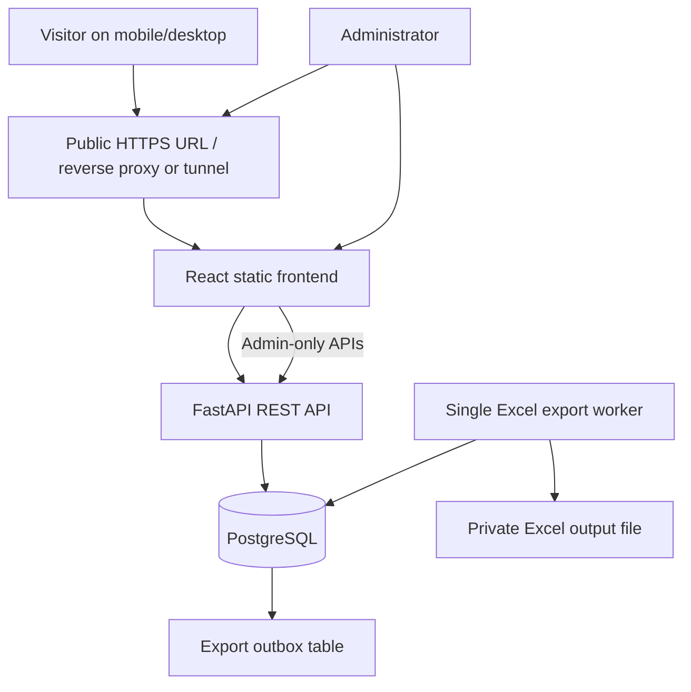

# Slot-Based Venue Registration System — Project Plan

**Document type:** Developer-ready implementation plan  
**Version:** 1.1  
**Date:** 18 October 2026
**Revision note:** Added group bookings with an administrator-configurable maximum of 10–20 guests per registration.  
**Target:** A Google Forms-like, shareable registration link hosted from one machine, with capacity-controlled time slots and Excel reporting.

---

## 1. Project summary

Build a lightweight web application through which one organizer can register a group for a venue visit. The form has two steps:

1. **Organizer details:** full name, phone number, and address for the person making the booking.
2. **Visit details:** select a time slot and enter the total number of guests covered by that booking.

One booking may cover multiple guests, but each booking is capped by a configurable `max_guests_per_registration` setting. The permitted setting range is **10–20 guests**, with an initial default of **15**; the event administrator can choose the exact cap (for example, 10, 15, or 20). A booking cannot exceed that cap even when the selected slot has sufficient capacity.

Every slot also has a maximum capacity measured in **people/guests**, not merely the number of submissions. If a slot has capacity 150 and 147 guests are already registered, a new registration for 4 guests must be rejected. The user interface should show the slot as full/disabled when no capacity remains, but the backend must always re-check capacity at submission time. The per-booking limit and per-slot limit are separate checks and both must pass.

Successful registrations are saved transactionally in a database. A background export process maintains an Excel workbook from those confirmed records. An administrator can view registrations, manage slots and capacity, and download a fresh Excel export.

### Key design decision

**PostgreSQL is the source of truth; Excel is the reporting/export file.** Do not use an Excel workbook as the live booking database. Concurrent reads/writes to a workbook make capacity enforcement and recovery harder. A database transaction prevents overbooking; a single-writer export worker then keeps Excel current.

---

## 2. Goals and non-goals

### Goals

- Shareable public URL that works on phones and desktops.
- Simple, accessible two-step form with clear validation and confirmation.
- Per-slot capacity enforcement under simultaneous submissions.
- No overbooking, including when the last few places are requested at the same time.
- Automatic, recoverable Excel reporting of successful registrations.
- Admin controls for slots, capacity, registrations, and exports.
- Reasonable controls against spam, duplicate submissions, and request spikes.
- All application components can run on one host/machine using Docker Compose.

### Non-goals for the first release

- Payments, ticket resale, QR admission scanning, waitlists, multi-venue management, and complex identity verification.
- A multi-region/high-availability deployment.
- SMS/WhatsApp OTP or confirmation notifications unless added as a separate feature.

---

## 3. Assumptions and configurable rules

Use the following as initial defaults, and make them configurable in the admin interface or environment configuration:

- One event/venue and one registration form.
- Each registration selects exactly one time slot.
- The person entering the form is the **organizer/booker**; the registration stores that person's contact details and the total guest count for the group. It does not collect every guest's individual details in the MVP.
- `guest_count` includes the organizer as one guest, unless the venue explicitly chooses a different rule. Show this rule clearly beside the guest-count field.
- Slot capacity is the maximum **total guests** for that slot.
- Minimum guests per booking: 1. `max_guests_per_registration` is an event setting from **10 through 20**; use **15** as the initial default. Admins may set it to 10, 12, 15, 20, etc. The backend must enforce the configured value, not just the frontend.
- Slot times use the venue's local timezone, configured explicitly (for example, `Asia/Kolkata`).
- Full slots remain visible but disabled and labelled **Full** by default. This is clearer than silently removing them. An admin option may hide full slots if required.
- A registration is confirmed only after the database transaction commits.
- A slot's capacity cannot be lowered below its current confirmed guest count.
- No automatic cancellation/expiry in MVP. If cancellation is added, the freed capacity must be restored in a database transaction.

---

## 4. Recommended technology stack

| Layer | Recommendation | Why |
|---|---|---|
| Frontend | React + TypeScript + Vite | Fast development, responsive single-page form, strong typing |
| UI and styling | Tailwind CSS + accessible component primitives (e.g. shadcn/ui) | Consistent, responsive controls and quick iteration |
| Backend API | Python + FastAPI + Pydantic | Typed request validation, clear REST endpoints, and OpenAPI documentation |
| Database | PostgreSQL | Transactions and atomic updates are appropriate for concurrent slot-capacity enforcement |
| ORM and migrations | SQLAlchemy 2.x + Alembic | Maintainable database access and schema changes |
| Excel generation | XlsxWriter or openpyxl, behind one export worker | Generate a downloadable `.xlsx` workbook without making it the live data store |
| Application packaging | Docker + Docker Compose | Run API, web server, database, and export worker together on one host |
| Reverse proxy / HTTPS | Caddy or Nginx; alternatively Cloudflare Tunnel for a hosted local machine | Public routing, TLS, and request handling |
| Tests | pytest + FastAPI TestClient/httpx + Playwright | Unit/API testing and browser-level flow testing |
| Monitoring/logging | Structured application logs + health endpoint + disk/database checks | Troubleshoot errors and detect capacity/export failures |

### Keep the first release simple

- **Redis is optional, not required for MVP.** Add it only if measured traffic warrants distributed rate limits, caching, or a separate queue.
- Use a PostgreSQL-backed `export_outbox` table for reliable Excel-export jobs instead of introducing a separate message broker at the start.
- Do not block a registration response while sending email/SMS or building a large workbook. Commit the registration first; run export/notification work separately.
- Avoid using SQLite as the production booking database for this design if many concurrent submissions are expected. PostgreSQL makes the capacity rule clearer and easier to operate under concurrent writes.

---

## 5. High-level architecture



### Components

1. **Frontend:** two-step form, live slot availability display, client-side validation, progress indicator, confirmation screen, and admin screens.
2. **FastAPI:** validates inputs, serves slot availability, applies rate limits, authenticates admin operations, performs atomic booking transactions, and exposes exports.
3. **PostgreSQL:** stores slots, registrations, booking-capacity counters, admin accounts/settings, and export jobs.
4. **Export worker:** consumes pending export jobs from the database, produces a consistent workbook, and marks export state. Only one worker should write a given workbook.
5. **Public edge/reverse proxy:** accepts public HTTPS traffic and routes requests to the app. The database and internal worker must not be exposed publicly.

---

## 6. User journey and UI design

### Page 1 — Visitor details

Fields:

- Full name (required)
- Phone number (required; normalize to a consistent format and validate the expected country format)
- Address (required; use a multi-line field)

UX requirements:

- Clear labels and examples; avoid placeholder-only labels.
- Inline validation beside the relevant field.
- Preserve entered details when navigating Back/Next within the form.
- Show `Step 1 of 2` and a visible Next button.
- Do not submit a registration or consume slot capacity on this step.

### Page 2 — Select slot and guests

Fields:

- Time slot (required; radio cards or a large dropdown with clear labels)
- Number of guests in the group (required integer; minimum 1; maximum displayed from the event setting, initially 15 and configurable from 10 to 20). The helper text should state that this is the total party size and whether the organizer is included.
- Small availability note, e.g. `35 places remaining` (optional; avoid exposing unnecessarily precise counts if the event requires that)

Slot UI states:

- **Available:** selectable; can show time and remaining places.
- **Almost full:** selectable with a subtle warning, if a threshold is configured.
- **Full:** disabled and labelled `Full`; cannot be selected.
- **Unavailable/closed:** disabled with a clear label.
- **Temporarily unavailable:** shown if the API cannot verify current availability; do not imply a slot is bookable while backend state is unknown.

UX requirements:

- On entering Page 2, fetch available slots from the backend.
- Refresh availability on a short interval while Page 2 is open, when the tab regains focus, and after changing guest count. Start with a modest interval such as 10–15 seconds; tune after testing.
- Validate that the requested guest count is no greater than `max_guests_per_registration`; show the allowed maximum next to the field and reject excess values both in the browser and on the server.
- If the selected guest count exceeds the remaining slot capacity shown, display a helpful message and prompt the user to choose another slot or reduce the guest count. The per-booking maximum does not override the slot's remaining capacity.
- On final submit, disable the button and show progress to prevent accidental double-clicks.
- If another visitor takes the remaining places first, show a clear message such as: `This slot has just filled up. Please choose another slot.` Keep the user's details so they do not need to restart.
- Provide a Back button to edit visitor details.

### Page 3 — Confirmation

After a successful server response, show:

- Confirmation/reference number
- Name and selected slot
- Registered guest count
- Registration date/time
- A brief instruction to save or screenshot the confirmation

Do not show a success page until the database confirms the registration has committed.

---

## 7. Slot capacity and concurrency design

This is the most important correctness requirement.

### The invariant

For every slot at all times:

`0 <= booked_guests <= capacity`

A registration is accepted only if both conditions pass:

`1 <= requested_guest_count <= max_guests_per_registration`

`booked_guests + requested_guest_count <= capacity`

For example, if the configured booking maximum is 15, a request for 16 guests must be rejected even if 100 places remain in the slot. A request for 12 guests can proceed only if the selected slot has at least 12 places remaining.

The capacity unit is **guests/people**. Do not compare the number of registration rows with the capacity unless the business rule is explicitly changed to limit bookings rather than people.

### Why frontend-only checks fail

Imagine a slot has 2 places remaining. Two visitors load the page and each sees `2 places remaining`. Both select 2 guests and submit at nearly the same time. If the server only checks availability before writing, both requests may be accepted. The final database state would exceed capacity.

Therefore, the frontend status is informational. **The database transaction is the final authority.**

### Recommended atomic booking strategy

Within one database transaction, attempt an atomic conditional update of the chosen slot. Only one competing transaction can consume the remaining capacity successfully when the requested guest count does not fit twice. Then insert the registration and its export-outbox event in the same transaction.

Illustrative SQL (adapt names to the final schema):

```sql
UPDATE time_slots
SET booked_guests = booked_guests + :guest_count,
    updated_at = CURRENT_TIMESTAMP
WHERE id = :slot_id
  AND status = 'OPEN'
  AND starts_at > CURRENT_TIMESTAMP
  AND booked_guests + :guest_count <= capacity
RETURNING id, booked_guests, capacity;
```

Application transaction outline:

```text
1. Validate the request, idempotency key, and `guest_count` against the event's configured `max_guests_per_registration`. Reject an above-limit request before consuming capacity.
2. If this idempotency key already has a completed registration, return that same result.
3. Begin a database transaction.
4. Run the conditional slot UPDATE above.
5. If no slot row is returned, roll back and return SLOT_FULL_OR_UNAVAILABLE (HTTP 409).
6. Insert the registration row with a unique confirmation/reference number.
7. Insert an export job/outbox row for this registration.
8. Commit the transaction.
9. Return the confirmation details to the visitor.
```

If the registration insert or outbox insert fails, roll back the entire transaction so the capacity counter is not consumed. The database update and registration must never be committed separately.

PostgreSQL supports row-level locking and transaction-based consistency controls; see the official documentation linked in the References section.

### Idempotency and duplicate requests

- Frontend generates a unique idempotency key for one final submission attempt and reuses it when retrying that same attempt after a timeout.
- Store it in a database column with a unique constraint.
- If the client retries after a network timeout, return the original registration rather than booking the guests a second time.
- Disable the submit button during the request, but do not rely on that as the duplicate protection.
- Optional duplicate policy: warn on the same normalized phone number and event/slot, or require admin review. Do not silently reject family/group registrations solely because the phone number repeats unless this is an explicit business rule.

### Slot availability endpoint

`GET /api/v1/slots?date=YYYY-MM-DD`

Example response:

```json
{
  "slots": [
    {
      "id": "slot_001",
      "label": "6:00 PM – 7:00 PM",
      "starts_at": "2026-11-01T18:00:00+05:30",
      "ends_at": "2026-11-01T19:00:00+05:30",
      "capacity": 150,
      "booked_guests": 150,
      "remaining_guests": 0,
      "status": "FULL",
      "selectable": false
    }
  ]
}
```

The API should calculate `remaining_guests = capacity - booked_guests`. The client uses `selectable` to render the initial UI, but booking submission still runs the atomic transaction. `GET /api/v1/event` should also return `max_guests_per_registration` so the frontend can display and validate the current cap. The server must read the authoritative setting during submission; it must not trust a value sent by the browser.

### Capacity changes and cancellation

- Do not let an administrator lower capacity below `booked_guests`.
- Do not delete a slot with confirmed registrations; close it instead.
- If cancellation is implemented, use a transaction to mark the booking cancelled and decrement `booked_guests` once. Protect against repeated cancellation with a status check and/or a unique cancellation event.
- Keep an audit record for admin-initiated capacity changes and cancellations.

---

## 8. Data model

Use database migrations to define and evolve these tables.

### `time_slots`

| Column | Type/notes |
|---|---|
| `id` | UUID or stable text ID, primary key |
| `label` | e.g. `6:00 PM – 7:00 PM` |
| `starts_at`, `ends_at` | timezone-aware timestamps; `ends_at > starts_at` |
| `capacity` | integer, greater than zero |
| `booked_guests` | integer, defaults to 0; never negative |
| `status` | `OPEN`, `CLOSED`, or `CANCELLED` |
| `created_at`, `updated_at` | timestamps |

Recommended database checks include `capacity > 0`, `booked_guests >= 0`, and `booked_guests <= capacity`. Because capacity is shared across concurrent transactions, retain the atomic conditional update even with these checks.

### `registrations`

| Column | Type/notes |
|---|---|
| `id` | UUID, primary key |
| `confirmation_code` | Unique, human-readable reference |
| `idempotency_key` | Unique key for safely retrying one submit operation |
| `full_name` | Required, length-limited text |
| `phone_number` | Required, normalized text; do not use a numeric type |
| `address` | Required text, length-limited |
| `slot_id` | Foreign key to `time_slots.id` |
| `guest_count` | Positive integer |
| `status` | `CONFIRMED` initially; later may include `CANCELLED` |
| `created_at` | Server timestamp |
| `updated_at` | Server timestamp |

Add indexes for `slot_id`, `created_at`, status, and any fields used regularly by admin filters. Do not index personal data without a clear query need.

### `export_outbox`

| Column | Type/notes |
|---|---|
| `id` | Primary key |
| `registration_id` | Foreign key to registrations |
| `event_type` | e.g. `REGISTRATION_CONFIRMED` |
| `status` | `PENDING`, `PROCESSING`, `DONE`, `FAILED` |
| `attempt_count` | Retry counter |
| `last_error` | Sanitized error summary; never store secrets |
| `created_at`, `processed_at` | Timestamps |

Insert the outbox row in the same transaction as the confirmed registration. This avoids a committed registration being permanently missed by the exporter if the application crashes between database commit and job scheduling.

### `event_settings`

Store settings for the event/form, including:

| Column | Type/notes |
|---|---|
| `id` | Primary key; one active settings row for the MVP |
| `max_guests_per_registration` | Integer with a database check constraint `BETWEEN 10 AND 20`; initial value 15 |
| `count_organizer_as_guest` | Boolean; initial value `true` |
| `timezone` | IANA timezone string, e.g. `Asia/Kolkata` |
| `updated_at` | Server timestamp |

Expose this in the admin UI. Validate updates on the server and in the database; never let a public form submission change the cap. If the event later needs a maximum outside 10–20, change the documented business rule deliberately rather than silently bypassing validation.

### `admin_users` (or equivalent)

Store admin accounts securely, using a password hashing algorithm intended for passwords. Never store plaintext passwords. For a very small single-admin deployment, a properly protected environment-based admin secret can be used initially, but admin login, session security, and audit logging are preferable.

---

## 9. Excel workbook requirements

### Workbook structure

Create a workbook such as `registrations.xlsx` with the following sheets:

1. **Registrations** — one row per registration.
2. **Slot Summary** — one row per slot, with capacity, booked guests, remaining guests, and number of registrations.
3. **Export Info** — export generation timestamp, event label, and optional export version.

Suggested `Registrations` columns (one row per **booking/group**, not one row per guest):

- Confirmation Code
- Registration Timestamp
- Full Name
- Phone Number
- Address
- Slot Label
- Slot Start
- Slot End
- Guest Count
- Registration Status

Store phone numbers as text to preserve leading `+` and leading zeros. Use explicit date/time formatting, freeze the header row, enable filters, and use readable column widths.

### Export lifecycle

1. Booking transaction inserts registration and pending outbox row.
2. One export worker picks pending rows in order; no two workers should write the same workbook concurrently.
3. Worker regenerates a consistent snapshot from committed database records (recommended for a small system), including the slot summary.
4. Write to a temporary file, validate that it can be opened, then atomically replace the current workbook. Never write directly to the final path while an administrator may download it.
5. Mark the processed outbox jobs `DONE`. If export fails, record the error and retry with backoff.
6. Admin also gets a **Download latest Excel** action that can trigger a fresh export or return a newly generated, current snapshot.

A full snapshot is intentionally preferred for this scale because it repairs drift and handles corrections/cancellations more safely than appending rows blindly. If the number of records later becomes very large, optimize the export process based on measured performance.

### Important export safeguards

- Workbook files must live outside the public static web directory.
- Require administrator authentication to download the workbook.
- Treat visitor-provided fields as untrusted text. Prevent spreadsheet formula injection when writing names, addresses, and other user input; do not allow values beginning with formula-significant characters to be interpreted as formulas.
- The database remains the recoverable master record. A workbook can always be rebuilt from it.
- Keep daily backups of the database and define retention/access rules for the workbook because it contains personal data.

---

## 10. API design

Use `/api/v1` as the versioned API prefix.

### Public endpoints

| Method | Endpoint | Purpose |
|---|---|---|
| `GET` | `/api/v1/event` | Return public event/form configuration and timezone |
| `GET` | `/api/v1/slots` | List current slots and availability for a date |
| `POST` | `/api/v1/registrations` | Validate request and atomically confirm a registration |
| `GET` | `/api/v1/registrations/{confirmation_code}/public` | Optional limited confirmation lookup; only expose safe fields and avoid guessable IDs |
| `GET` | `/health/live` | Process liveness check |
| `GET` | `/health/ready` | Check API and database readiness |

The confirmation lookup endpoint is optional. If it is not needed, keep confirmation details only in the successful `POST` response and do not create a public lookup route.

### Admin endpoints (authentication required)

| Method | Endpoint | Purpose |
|---|---|---|
| `POST` | `/api/v1/admin/auth/login` | Admin login/session |
| `GET` | `/api/v1/admin/registrations` | Paginated/filterable registration list |
| `GET` | `/api/v1/admin/registrations/export` | Download a current Excel export |
| `POST` | `/api/v1/admin/slots` | Create a time slot |
| `PATCH` | `/api/v1/admin/slots/{slot_id}` | Change label/status/capacity, subject to rules |
| `GET` | `/api/v1/admin/slots` | List all slots, including closed/full slots |
| `GET` | `/api/v1/admin/summary` | Registration and capacity summary |
| `GET` | `/api/v1/admin/export-status` | Inspect latest export timestamp and failures |

### Error response contract

Use consistent JSON errors, for example:

```json
{
  "error": {
    "code": "SLOT_FULL_OR_UNAVAILABLE",
    "message": "This slot is no longer available. Please choose another slot."
  }
}
```

Recommended cases:

- `400` — malformed request.
- `401/403` — unauthenticated/unauthorized admin action.
- `409` — slot full, closed, or idempotent/business conflict.
- `422` — valid JSON but field validation failed.
- `429` — too many requests.
- `500/503` — unexpected or temporarily unavailable server condition; do not leak stack traces or secrets.

---

## 11. Traffic management and performance

The exact required capacity depends on how many users arrive at once, the page weight, the host's CPU/RAM, database settings, and network upload speed. A one-machine setup cannot guarantee availability during a power, network, or hardware failure. Load-test the expected peak rather than promising a fixed number of concurrent visitors based only on slot capacity.

### Baseline controls

1. **Serve static frontend assets efficiently.** Keep API requests small; compress and cache versioned static files.
2. **Keep public reads cheap.** Slot list endpoint returns only slot metadata and calculated availability, not visitor records.
3. **Use database connection pooling.** Configure a small pool suitable for the host and avoid opening a new database connection per request.
4. **Use transaction boundaries carefully.** The booking transaction should do only the conditional capacity update, registration insert, and outbox insert. Avoid email, file I/O, or third-party calls while holding the transaction.
5. **Rate-limit public endpoints.** Apply per-IP and/or per-session limits to registration attempts and availability polling; return `429 Too Many Requests` when limits are exceeded. Configure the rate limiter to respect proxy headers only when the trusted proxy is known.
6. **Add bot/friction controls proportionally.** Start with honeypot or timing checks and add CAPTCHA only if abuse is observed or event risk justifies it.
7. **Bound request sizes and timeouts.** Validate field lengths, reject huge payloads, use request/connection timeouts, and limit concurrent expensive operations.
8. **Add caching carefully.** Slot availability can be cached briefly for read efficiency only if the booking endpoint always rechecks the database. Never use cached availability to authorize a booking.
9. **Keep exports off the request path.** A spike in registrations should not cause every API request to generate an Excel file.
10. **Add monitoring.** Log request latency, HTTP status, database errors, slot-full conflicts, pending export jobs, export failures, CPU/RAM/disk use, and database backup status. Do not log full addresses or phone numbers by default.

### During a burst of simultaneous bookings

- Requests may briefly contend on the same slot row; this is expected and preferable to overbooking.
- A successful transaction consumes capacity; competing transactions then see the updated counter and either succeed if enough places remain or return `409`.
- Use short database lock/statement timeouts and return a retryable response if the server is genuinely overloaded. Do not mark an uncertain request as confirmed.
- The frontend should refresh slot availability after a `409` and let the visitor choose a new slot.

### Capacity tests and acceptance targets

Use a load-testing tool such as Locust or k6. Establish a target with the event owner (for example, a chosen burst size and completion-time percentile) before deployment. Test realistic network and database conditions, not just localhost.

At minimum, test:

- Many simultaneous requests for the same slot when only a few places remain.
- Simultaneous requests for different slots.
- Requests whose guest count exactly equals, is below, and exceeds remaining capacity.
- Client timeouts followed by idempotent retries.
- Database restart, application restart, exporter restart, and disk-full/export failure scenarios.

Acceptance rule: after each load test, the database must satisfy `booked_guests <= capacity`, and the sum of confirmed registrations' `guest_count` for each slot must equal that slot's `booked_guests` (unless the product deliberately supports another audited adjustment process).

---

## 12. Public link and single-machine deployment

A web form running at `localhost` is available only on the host machine. To behave like Google Forms, it must be reachable from the internet through a public URL or an appropriate private network.

### Option A — One always-on machine plus a public tunnel

- Run Docker Compose on a desktop, mini-PC, or server.
- Keep the machine powered on with a stable internet connection.
- Publish only the frontend/reverse-proxy route through a tunnel, such as Cloudflare Tunnel; do not publish PostgreSQL directly.
- Use a stable domain/subdomain for a durable link. Cloudflare's published application setup requires a domain on Cloudflare; a quick tunnel can be useful for temporary testing but should not be treated as a permanent event-registration URL.
- Configure the service to restart automatically and maintain backup/export paths outside disposable containers.

**Limitations:** the application is unavailable if the host is shut down, crashes, loses internet, or has insufficient upload bandwidth. A tunnel provides a route to the app but does not turn a home computer into a highly available service.

### Option B — One small VPS (recommended for a real public event)

- Deploy the same Docker Compose stack on one virtual private server.
- Configure a domain and HTTPS via Caddy/Nginx or a managed edge service.
- Keep the API, database, and worker on that one host; expose only the public HTTP(S) endpoint.
- Enable unattended security updates where appropriate, monitoring, and automated off-host backups.

This still satisfies the **single-machine application** requirement while offering a more reliable always-on environment than a personal laptop. It is not high availability; all components remain on one server.

### Docker Compose service layout

```text
services:
  frontend-or-proxy  # public entry point; serves frontend and routes /api
  api                # FastAPI application
  postgres           # persistent database volume; private network only
  excel-worker       # one instance; consumes export_outbox and writes workbook
  tunnel             # optional; only if using a tunnel-based public link
```

- Put secrets in an `.env` file excluded from version control or in the host's secret manager.
- Do not expose database ports on the public interface.
- Add health checks and restart policies.
- Use persistent volumes for PostgreSQL data and generated exports.
- Pin tested dependency/container versions for deployment; update them through a tested release process rather than using unreviewed floating versions in production.

---

## 13. Security and privacy checklist

The form collects phone numbers and addresses, so treat these records as personal data.

- HTTPS for all public traffic.
- Admin authentication and role checks for every admin endpoint.
- Secure password hashing; strong session cookies (`HttpOnly`, `Secure`, and appropriate `SameSite`) if cookie-based sessions are used.
- CSRF protection if browser cookies authenticate state-changing admin requests.
- Server-side validation even when frontend validation exists.
- Parameterized database queries/ORM; no SQL built by string concatenation from user inputs.
- Rate limits, request-size limits, timeouts, and basic anti-bot controls.
- Keep secrets, passwords, phone numbers, and addresses out of logs and exception responses.
- Restrict workbook download to admins; never place it under a publicly served static directory.
- Protect backups and workbook files with filesystem permissions and encryption at rest where available.
- Define retention: when registrations and exports should be deleted after the event, and who can access them.
- Provide a clear notice explaining why the information is collected and how it will be used; collect only fields that are actually required.
- Escape/neutralize spreadsheet formula-like values in the exported workbook.
- Audit admin changes to capacity, slot status, exports, and cancellation actions.
- Keep database backups off the host and periodically test restoring one.

---

## 14. Admin panel requirements

MVP admin screens:

1. **Dashboard:** total confirmed registrations, total guests, total capacity, remaining guest places, full slots, and latest export status.
2. **Slot management:** create/edit slot time, set capacity, open/close slot, view booked guests and remaining places. Prevent invalid capacity edits.
3. **Registration table:** paginated list with search/filter by slot, status, date, and confirmation code. Mask phone numbers by default when full values are not needed.
4. **Excel export:** download current `.xlsx`; show the most recent successful export time and any export error.
5. **Operational status:** pending export jobs and basic readiness/backup status.

Keep the admin panel separate in navigation and protected by authentication. Do not rely on an obscure URL as security.

---

## 15. Suggested repository structure

```text
venue-registration/
├── frontend/
│   ├── src/
│   │   ├── pages/                 # VisitorDetails, SlotSelection, Confirmation, Admin
│   │   ├── components/             # Form fields, SlotCard, ProgressIndicator
│   │   ├── api/                   # Typed API client
│   │   ├── validation/             # Frontend schemas
│   │   └── styles/
│   └── Dockerfile
├── backend/
│   ├── app/
│   │   ├── api/v1/                # Public and admin route handlers
│   │   ├── core/                   # Settings, auth, logging, rate limits
│   │   ├── db/                     # Engine, sessions, models
│   │   ├── schemas/                # Pydantic request/response models
│   │   ├── services/               # Booking, slot availability, export
│   │   ├── workers/                # Excel export worker
│   │   └── main.py
│   ├── migrations/                 # Alembic revisions
│   ├── tests/                      # Unit, API and concurrency tests
│   └── Dockerfile
├── deploy/
│   ├── compose.yaml
│   ├── Caddyfile                   # or nginx configuration
│   └── backup/                     # documented scripts, not generated secrets
├── exports/                        # private mounted output directory; not public web root
├── .env.example
├── .gitignore
└── README.md
```

---

## 16. Implementation phases

### Phase 1 — Project foundation

- Create repository and frontend/backend projects.
- Add Docker Compose services for API and PostgreSQL.
- Configure environment variables, logging, health endpoints, and database migrations.
- Define timezone and event configuration.

**Exit criteria:** all services start with one command; the API can connect to PostgreSQL; migrations can be applied from a clean database.

### Phase 2 — Database and slot management

- Implement `time_slots`, `registrations`, `event_settings`, admin authentication, and `export_outbox` tables.
- Add the admin setting for `max_guests_per_registration` (10–20; default 15) and the organizer-counting rule.
- Implement admin APIs for creating and closing slots.
- Add constraints, indexes, and validation for slot dates/capacity.
- Prevent lowering capacity beneath already booked guests.

**Exit criteria:** admin can create slots and query correct capacity/remaining places.

### Phase 3 — Public form UI

- Build responsive Page 1 and Page 2.
- Add accessible labels, inline validation, loading/error states, and progress indicator.
- Integrate `GET /api/v1/slots` and display Available/Full/Closed states.
- Preserve data when moving backward between form steps.

**Exit criteria:** keyboard and mobile users can complete both steps; full slots are visibly disabled; client validation works.

### Phase 4 — Booking transaction and concurrency

- Implement final registration API with idempotency keys.
- Use the atomic conditional slot update in the same transaction as the registration and outbox inserts.
- Return `409` when capacity has run out or the slot is closed.
- Generate unique confirmation codes.
- Add integration tests that submit many bookings concurrently against one slot.

**Exit criteria:** no test can push `booked_guests` above capacity; retries do not create duplicate registrations; a failed insert rolls back the capacity update.

### Phase 5 — Excel export worker

- Implement a single export worker polling/claiming pending outbox rows safely.
- Generate `Registrations`, `Slot Summary`, and `Export Info` sheets.
- Write to a temporary workbook and atomically replace the final file.
- Add retries, export status, and authenticated download.
- Test formula-injection handling, workbook permissions, and exporter restarts.

**Exit criteria:** every committed registration appears in the next successful export; failed exports are visible and retryable; the workbook can be rebuilt from PostgreSQL.

### Phase 6 — Admin UI and security

- Build dashboard, slot management, registration table, and export controls.
- Add rate limits and abuse controls.
- Complete admin authentication, secure headers, CORS restrictions, and error sanitization.
- Add data notice, retention policy, and backup plan.

**Exit criteria:** public users cannot access admin data or downloads; common abuse patterns are throttled; sensitive data is not exposed in logs.

### Phase 7 — Load testing and deployment

- Run unit, API, browser, concurrency, failure-recovery, and load tests.
- Check the registration counter against the aggregate confirmed guest count per slot.
- Build production images and configure the reverse proxy/public URL.
- Configure backups, health checks, disk alerts, and a documented restore test.
- Perform an end-to-end rehearsal using the actual form link and several devices.

**Exit criteria:** agreed peak-load scenario passes, backups are restorable, HTTPS works, and the event owner signs off on the registration and export workflow.

---

## 17. Test plan

### Functional tests

- Missing name, phone, address, slot, or guest count is rejected.
- Negative, fractional, zero, and above-`max_guests_per_registration` guest counts are rejected.
- Test booking limits at 10, 15, and 20; the API must reject a value one greater than the active setting even when slot capacity is sufficient.
- Changing the admin setting outside 10–20 is rejected; changing it does not invalidate already-confirmed bookings.
- Closed, past, and full slots cannot be booked.
- Exact remaining capacity can be booked successfully.
- A request above remaining capacity is rejected without changing the counter.
- Confirmation includes the correct slot and guest count.
- Excel output includes all expected columns and summary totals.

### Concurrency tests

- Seed a slot with 100 capacity and 90 booked guests; launch many concurrent requests with a range of guest counts. Confirm the final total never exceeds 100.
- Seed 1 remaining place and launch multiple 1-guest requests; exactly one should be confirmed.
- Replay the same idempotency key concurrently; it must create only one registration.
- Simulate timeout after commit and retry; original confirmation should be returned.
- Compare each slot's `booked_guests` to `SUM(guest_count)` from confirmed registrations after the test.

### Failure/recovery tests

- Restart API during traffic.
- Restart export worker while jobs are pending.
- Make export directory temporarily unavailable and ensure database bookings continue while the export backlog is surfaced and retried.
- Restore database backup to a clean environment and regenerate Excel.
- Test public URL failure when the host is offline and ensure operators have a clear recovery procedure.

---

## 18. Deployment and operations checklist

Before opening registration:

- [ ] Confirm event timezone and all slot start/end times.
- [ ] Confirm each slot's total guest capacity and set `max_guests_per_registration` to the approved value from 10–20 (initial default 15).
- [ ] Confirm whether the organizer is included in the guest count and show the rule clearly in the form.
- [ ] Confirm whether the submitter is included in guest count.
- [ ] Test a full slot and a nearly full slot.
- [ ] Run concurrency/load test and inspect database consistency.
- [ ] Verify public HTTPS URL on Android, iPhone, and desktop browsers.
- [ ] Verify admin login and confirm a public user cannot download Excel.
- [ ] Confirm export freshness and workbook contents.
- [ ] Test database backup and restore.
- [ ] Ensure disk space, host uptime, and network availability are sufficient for the registration window.
- [ ] Decide retention/deletion date for personal data.
- [ ] Keep an operational contact and a manual fallback process for a prolonged outage.

During registration:

- Monitor API errors/latency, slot-full conflicts, database health, export queue depth, and free disk space.
- Do not manually edit the Excel workbook as the authoritative record. Fix source records through an authenticated admin workflow/database migration, then regenerate Excel.
- If a slot is full, let the UI show `Full`; do not increase capacity without venue approval.

After the event:

- Export and securely archive the final workbook.
- Reconcile totals by slot against confirmed registration records.
- Close the form and slots.
- Apply the agreed personal-data retention policy.

---

## 19. MVP scope recommendation

For the first release, build only:

- Two-step responsive group-registration form: one organizer's contact details and one guest count per booking, capped by an admin-configurable maximum from 10 to 20 (default 15).
- Public slot availability endpoint and disabled/full slots.
- PostgreSQL-backed atomic capacity enforcement.
- Idempotent submission and confirmation code.
- Single Excel export worker plus authenticated Excel download.
- Basic admin dashboard and slot management.
- Rate limiting, HTTPS, logs, backups, and load tests.

Defer OTP notifications, waitlists, QR check-in, and advanced analytics until the core booking flow is proven reliable.

---

## 20. Key risks and mitigations

| Risk | Mitigation |
|---|---|
| Two visitors take the same final places | Atomic conditional update inside a database transaction; never trust client availability alone |
| One organizer requests more guests than permitted | Enforce `max_guests_per_registration` on the server and in event settings; default 15, configurable from 10 to 20 |
| User double-clicks or retries after a timeout | Idempotency key with a database uniqueness constraint |
| Excel write fails or workbook is corrupted | PostgreSQL remains source of truth; outbox, retries, single writer, temporary-file replacement, and rebuildable snapshots |
| Public traffic overwhelms one machine | Load-test, cache static assets, rate-limit, keep transactions short, monitor resources; move to a larger host if measurements require it |
| Host/internet/power failure | Always-on server/VPS, automatic restart, off-host database backups, tested restore and manual fallback |
| Personal information leaks | Admin-only access, HTTPS, minimal logs, private file permissions, controlled retention and protected backups |
| Bot traffic fills slots | Rate limiting, abuse monitoring, optional CAPTCHA and admin review rules |

---

## 21. Definition of done

The system is ready for real registrations when all of the following are true:

1. Visitors can complete the two-step form on mobile and desktop.
2. Full/closed slots are visibly unselectable, server-side validation prevents stale UI from causing overbooking, and one booking cannot exceed the configured 10–20 guest cap.
3. Concurrent booking tests prove `booked_guests <= capacity` for every slot.
4. Repeated requests with the same idempotency key do not create duplicate bookings.
5. Confirmed registrations are reflected in the Excel snapshot, with export errors visible and recoverable.
6. Only authorized admins can view personal data or download the workbook.
7. HTTPS, rate limits, health checks, backups, and a restoration procedure are in place.
8. The chosen deployment passes the agreed peak-load test and the event owner has tested the final public link.

---

## 22. Official references

- PostgreSQL — Explicit locking and row-level locks: https://www.postgresql.org/docs/17/explicit-locking.html
- PostgreSQL — Application-level consistency checks: https://www.postgresql.org/docs/18/applevel-consistency.html
- Cloudflare Tunnel — Getting started and publishing an application: https://developers.cloudflare.com/tunnel/get-started/
- Cloudflare Tunnel — Public hostname routing: https://developers.cloudflare.com/tunnel/concepts/routing/
- OWASP — REST Security Cheat Sheet (including rate-limit responses): https://cheatsheetseries.owasp.org/cheatsheets/REST_Security_Cheat_Sheet.html
- OWASP — Denial of Service Cheat Sheet: https://cheatsheetseries.owasp.org/cheatsheets/Denial_of_Service_Cheat_Sheet.html

---

## Final recommendation

Implement the system as **React + FastAPI + PostgreSQL + one serialized Excel export worker**, packaged with Docker Compose on one host. Treat each submission as a group booking: store one organizer's details and the party size, enforce the configurable 10–20 guest maximum per booking (default 15), and separately enforce the total guest capacity for the selected slot. The critical booking logic should be database-transactional, and Excel should be generated from committed registrations. For a public event, use an always-on VPS or an always-on machine with a properly configured HTTPS public route; a laptop-hosted tunnel is suitable for a prototype but creates an availability dependency on that laptop and its internet connection.
